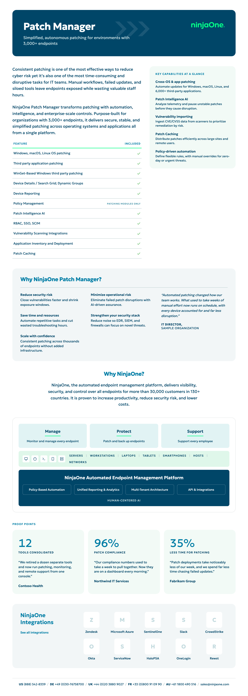
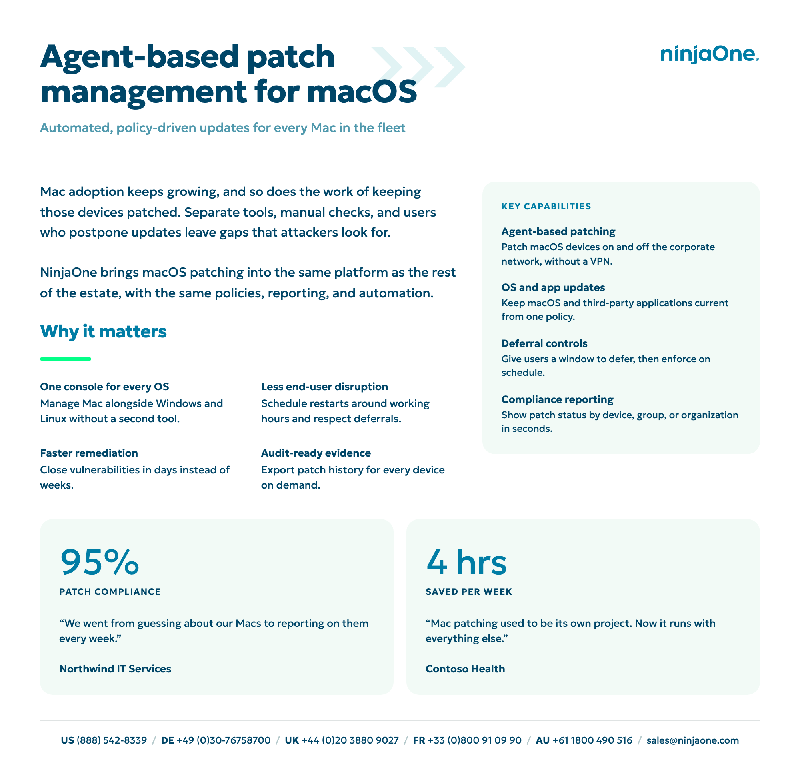
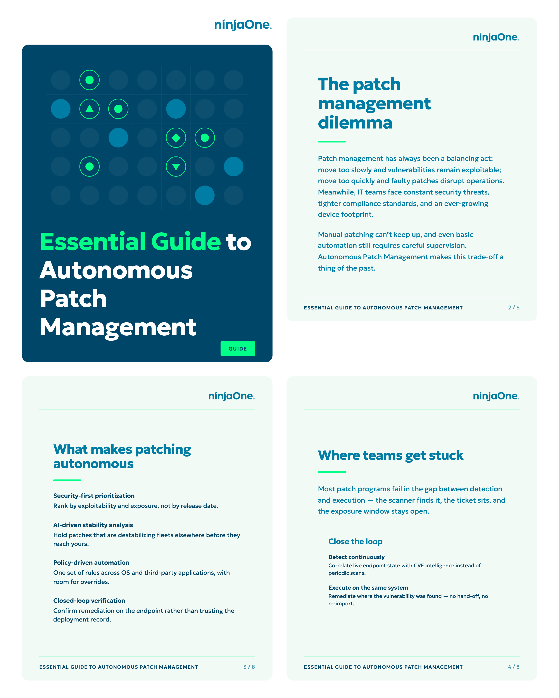
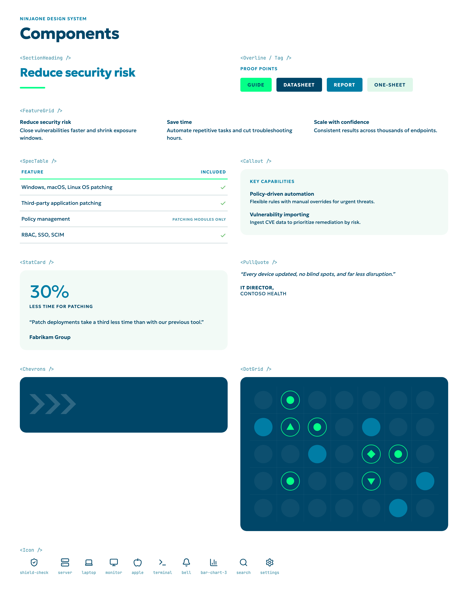
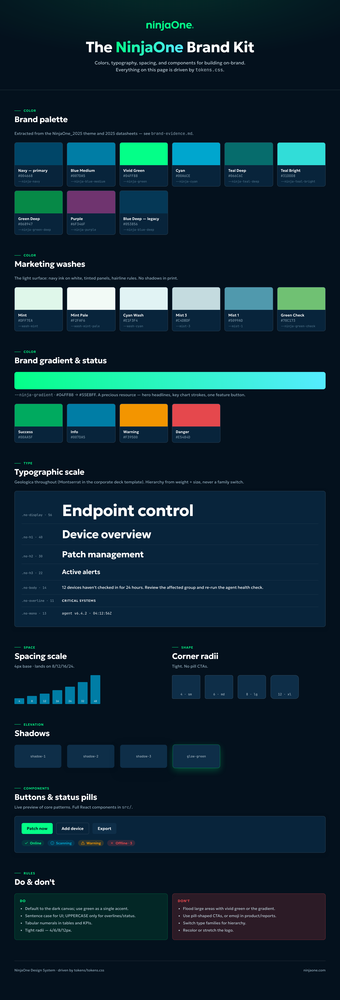

# NinjaOne Design System

Design tokens and React components for NinjaOne collateral: datasheets, one-sheets, guides and briefs on a light document surface (navy ink on white, tinted panels, hairline rules). Colors and typefaces are taken from 2025 NinjaOne collateral; sources are listed in [`docs/brand-evidence.md`](docs/brand-evidence.md).

## Samples

Rendered from the demo app in this repo. Customer names are fictional.

**Datasheet** - navy hero band, feature table, capability rail, value props, platform diagram, proof points, integrations and regional footer. PDF: [`samples/datasheet.pdf`](samples/datasheet.pdf)



**One-sheet** - the light hero variant at one-sheet length. PDF: [`samples/one-sheet.pdf`](samples/one-sheet.pdf)



**Guide** - cover with the dot-grid motif, then interior pages with running headers, page numbers and section headings.



**Components**



**Tokens and brand guidelines** - palette, washes, gradient, status colors, type scale, spacing, radii and shadows, all driven by `tokens/tokens.css` ([`docs/brand-guidelines.html`](docs/brand-guidelines.html)).



## Files

- **tokens/tokens.css** - every token as a CSS custom property, plus the `.no-*` type classes and the surface scopes
- **tokens/tokens.json** - the same tokens in W3C DTCG format, for Figma (Tokens Studio), Style Dictionary or a Tailwind theme
- **src/** - the components, in a flat folder. `Datasheet.jsx` and `Guide.jsx` are full documents built from the rest
- **docs/brand-guidelines.html** - visual spec: palette, type scale, spacing, radii, do/don't. Open it in a browser
- **docs/brand-evidence.md** - which source document each brand value came from
- **assets/** - the wordmarks
- **demo/** - the demo app `index.html` loads, including the one-sheet and component gallery. Not part of the published package
- **samples/** - rendered screenshots and PDFs

> `tokens.css` and `tokens.json` hold the same token set in two formats. If you edit one, update the other.

## Quick Start

### Run the demo

```bash
npm install
npm run dev
```

Open the URL Vite prints. A switcher at the bottom moves between **Datasheet**, **One-sheet**, **Guide** and **Components**.

- `?doc=datasheet`, `?doc=one-sheet`, `?doc=guide` or `?doc=components` opens that document
- `?nav=0` hides the switcher (for printing or screenshots)

`npm run build` writes a static build of the demo to `dist/`.

### Export to PDF

Open a document with `?nav=0` and print to PDF from the browser with background graphics on. The PDFs in `samples/` were made this way with headless Chromium.

### Use the components

Load the tokens once, globally, then import components:

```jsx
import 'ninjaone-design-system/tokens/tokens.css';
import { DocHero, SpecTable, Callout, DocFooter } from 'ninjaone-design-system';

export function ProductBrief() {
  return (
    <div className="no-surface-doc">
      <DocHero variant="band" title="Patch Manager" subtitle="Autonomous patching at scale" />
      <SpecTable rows={[{ label: 'Cross-OS patching' }, { label: 'Policy management', note: 'Patching modules only' }]} />
      <DocFooter />
    </div>
  );
}
```

Components ship as `.jsx` source with `.d.ts` signatures beside them - no build artifact, no bundled CSS. They work in Vite, Next, or any bundler that handles JSX and asset imports. Not installing from a registry? Copy `tokens/`, `assets/` and `src/` into your project; the imports are relative.

For plain HTML with no build step, `tokens/tokens.css` on its own is enough:

```html
<link rel="stylesheet" href="tokens/tokens.css">

<div class="no-surface-doc">
  <h1 class="no-h1">Patch Manager</h1>
  <p class="no-body">Simplified, autonomous patching.</p>
</div>
```

## Tokens

| Token | Hex | Use |
|---|---|---|
| `--ninja-navy` | `#004668` | **Primary.** Hero bands, covers, headings, body ink |
| `--ninja-blue-medium` | `#007DA5` | Subheads, stat figures, overlines, wordmark on light |
| `--ninja-green` | `#04FF88` | Wordmark on dark, rules, accents |
| `--ninja-cyan` | `#00A6CE` | Links |
| `--ninja-teal-deep` / `--ninja-teal-bright` | `#066C6C` / `#31DDD8` | Supporting accents |
| `--ninja-green-deep` | `#068947` | Supporting accent |
| `--ninja-green-check` | `#70C173` | "Included" checkmarks |
| `--ninja-purple` | `#6F346F` | Secondary accent |

- **Status:** success `#00AA5F`, info `#007DA5`, warning `#F39500`, danger `#E5484D`. Print uses a softer red (`--status-danger-print`).
- **Gradient:** `--ninja-gradient` (`#04FF88` to `#55EBFF`) only on a hero headline, one key chart stroke, or one feature button. Never as a broad fill.
- **Grounds:** body ink on light is navy, not black. Tinted grounds come from `--wash-*`, rules and dividers from `--mist-*`.
- **Type:** **Geologica** for collateral, **Montserrat** for corporate decks (`--font-deck`). Hierarchy comes from weight and size, never from switching family. Numerals are tabular.
- **Scale:** display 56, h1 40, h2 30, h3 22, h4 18, body 14, small 13, caption 12, overline 11. Classes: `.no-display`, `.no-h1`-`.no-h4`, `.no-body`, `.no-small`, `.no-caption`, `.no-overline`, `.no-mono`, `.no-kpi`.
- **Space and radii:** 4px base (`--space-1` to `--space-12`). Radii 4 (inputs, tags), 6 (buttons), 8 (cards), 12 (large elements), 16 (document panels, hero bands, covers). The document surface uses hairline rules and tinted grounds instead of shadows.

## Components

| Component | What it is |
|---|---|
| `DocHero` | Datasheet masthead. `variant="band"` = navy band, green wordmark; `variant="light"` = white ground, blue wordmark. Both carry the chevron motif |
| `DocFooter` | Regional contact line that closes every page |
| `GuideCover` | Navy cover panel with dot-grid motif, two-tone headline and format tag |
| `GuidePage` | Interior guide page with running header, green rules, running title and page number |
| `SectionHeading` | Blue heading over a short green underline |
| `Overline` | Uppercase, letterspaced section label |
| `FeatureGrid` | Tiles of a bold title over short body copy |
| `SpecTable` | Feature/included table with green checks and qualifying notes |
| `Callout` | Mint sidebar rail |
| `StatCard` | Oversized proof-point figure with a quote |
| `PullQuote` | Italic quote with uppercase attribution |
| `PlatformDiagram` | Manage / Protect / Support figure |
| `LogoWall` | Integrations panel. You supply the partner marks |
| `Tag` | Format chip, e.g. GUIDE, REPORT, DATASHEET |
| `Chevrons`, `DotGrid` | Decorative motifs (`>>>` behind hero headlines, cover lattice), `aria-hidden` |
| `Icon` | Kebab-case Lucide names, e.g. `<Icon name="shield-check" />`. 2px stroke, 14-18px, inherits text color |

For exact props, read the `.d.ts` beside each component. Only the icons the kit uses are registered. To add more:

```jsx
import { Rocket } from 'lucide-react';
import { registerIcons } from 'ninjaone-design-system';

registerIcons({ 'rocket': Rocket });
```

## Building a new document

1. **Start from the closest example.** `src/Datasheet.jsx` (multi-section datasheet), `demo/OneSheet.jsx` (single page) or `src/Guide.jsx` (long-form). Copy it under a new name.
2. **Wrap the page in `.no-surface-doc`.** That sets the white ground, navy ink and Geologica type.
3. **Pick a masthead.** `DocHero variant="band"` for a product datasheet, `variant="light"` for a one-sheet, `GuideCover` + `GuidePage` for guides.
4. **Compose the body from blocks.** Common layout: two columns with intro copy and a `SpecTable` left and a `Callout` rail right, then a tinted section of `FeatureGrid` plus `PullQuote`, a row of `StatCard`s, and the `DocFooter`.
5. **Space with tokens.** Use `var(--space-*)`, `var(--radius-doc)`, `var(--wash-*)` and `var(--mist-*)` rather than hard-coded values.
6. **Preview and export.** Add the document to the `DOCS` list in `demo/main.jsx`, run `npm run dev`, open `?doc=<id>&nav=0`, and print to PDF.

**Voice:** sentence case everywhere except product proper nouns and overlines (uppercase, used sparingly). Informative, not enthusiastic. Buttons use imperative verbs ("Patch now"). No exclamation points, no emoji, tabular numerals in tables and stats.

## Requirements

- React 18 or later
- `lucide-react`
- Node.js and npm to run the demo (Vite)

## Known limitations

- **Sample copy.** Testimonials, quotes, statistics and customer names in the demos and samples are illustrative, not real customer results.
- **Fonts** load from Google Fonts. Swap in licensed font files for production.
- **Icons** are Lucide, standing in for NinjaOne's own icon set.
- **Logos** are raster crops; vector originals should replace them. Only the green (dark grounds) and `#007DA5` (light grounds) wordmarks are included.
- **Partner logos** for `LogoWall` are not included.

## License

The code is released under the MIT License (see [`LICENSE`](LICENSE)). The NinjaOne name, wordmark and brand assets in `assets/` belong to NinjaOne and are not covered by that license.
